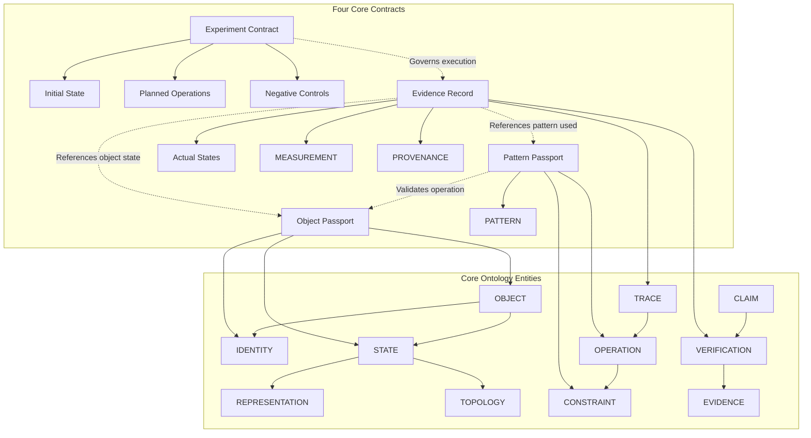

# PCRS — CONTRACT RELATIONSHIPS & ARCHITECTURE GRAPH

**Документ:** `docs/architecture/PCRS_CONTRACT_RELATIONSHIPS.md`  
**Проект:** PCRS (Paper Construction Reasoning Stand)  
**Репозиторий:** `pcrs-theory`  
**Фаза:** Architecture Design (Package 1)  
**Дата фиксации:** 24 октября 2026 г.  
**Статус документа:** `RATIFIED / RELATIONSHIPS_SPECIFIED`  

---

## 1. Purpose and Architecture Design Principles

To prevent monolithic schema bloat, the PCRS architecture strictly separates four distinct contracts:
1. **Object Passport** — Defines what an object is, its identity, canonical state reference, geometry, provenance, and constraints.
2. **Pattern Passport** — Defines reusable reasoning knowledge, preconditions, required inputs, intended effect, postconditions, and independent verification criteria.
3. **Experiment Contract** — Defines a controlled test hypothesis, initial state, planned operations, expected observations, acceptance criteria, and negative controls.
4. **Evidence Record** — Records actual input/output states, executed operations, measurements, verifier results, failure reasons, and execution provenance.

---

## 2. Contract Relationship Graph (Mermaid)

---

## 3. Reference Rules Between Contracts

1. **Object Passport $\leftrightarrow$ Evidence Record:** An Evidence Record references the specific Object Passport version and state identifier evaluated during an operation.
2. **Pattern Passport $\leftrightarrow$ Evidence Record:** When an operation executed within an experiment instantiates a registered pattern, the Evidence Record references the `pattern_id` and checks whether postconditions matched the Pattern Passport criteria.
3. **Experiment Contract $\leftrightarrow$ Evidence Record:** An Experiment Contract acts as the specification (plan), while the Evidence Record acts as the immutable log of execution (actual realization).
4. **Producer Claim $\leftrightarrow$ Verifier Evaluation:** Agent claims reference specific states or operations; the independent verifier evaluates them and outputs an Evidence Record without trusting the producer's internal assumptions.
